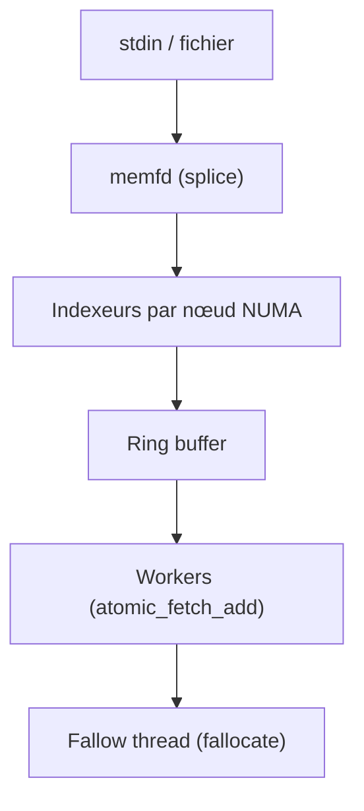

# jkool702/forkrun

> Parallélisateur bash en streaming qui remplace GNU Parallel et `xargs -P` sur machines multicœurs et NUMA.

## Le problème
GNU Parallel passe beaucoup de temps à distribuer le travail : sur de nombreux cœurs, la plupart restent inactifs.

## Ce que ça fait vraiment
`frun.bash` est un fichier unique à sourcer, avec une extension C compilée intégrée. Les données entrent par `splice()` dans un memfd, des indexeurs SIMD par nœud NUMA découpent les lots, et les workers les réclament par un `atomic_fetch_add`. Un lot perdu par un worker mort est repris. Les chiffres du README sont des mesures de l'auteur sur un i9-7940X. Un frontend Python existe aussi.

## Comment c'est branché
Schéma simplifié d'après la fiche, sans diagramme fourni.


## Essayer
```bash
wget https://raw.githubusercontent.com/jkool702/forkrun/main/frun.bash
source ./frun.bash
frun my_bash_func < inputs.txt
cat file_list | frun -k sed 's/old/new/'
```

## Coût et pièges
Gratuit. Bash 4.4 ou plus, Linux 3.17 ou plus, GNU coreutils, x86_64 en priorité. Un binaire en base64 est exécuté à l'import : l'auteur renvoie à son workflow CI pour l'audit.

## Ce que ce n'est pas
Ce n'est pas utile sous 100 000 lignes, ni pour des tâches GPU. Les gains de 50 à 3300 fois sont des microbenchmarks.

## Alternatives
Le README compare avec GNU Parallel et `xargs -P`.

## Pour toi
À surveiller : intéressant pour la préparation de gros fichiers en shell, mais exécute un binaire embarqué et reste jeune.

