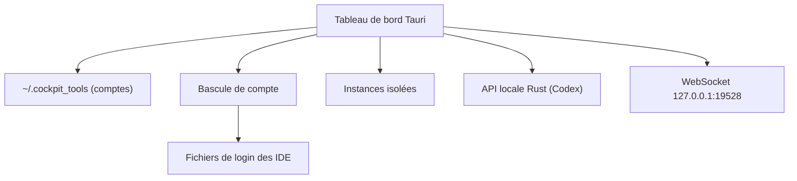

# jlcodes99/cockpit-tools

> Desktop application that manages several AI IDE accounts, tracks their quotas and launches parallel instances.

## The problem
Juggling several Codex, Copilot, Cursor, Windsurf or Kiro accounts means logging out and back in, with no view of the remaining quotas.

## What it actually does
Imports accounts (OAuth, token, JSON), displays quotas per platform, switches the active account by rewriting each client's login files and launches isolated instances. A local Rust API service relays Codex to a pool of accounts. A local WebSocket (port 19528) serves plugins.

## How it is wired


## Trying it
```bash
brew tap jlcodes99/cockpit-tools https://github.com/jlcodes99/cockpit-tools
brew install --cask cockpit-tools
# ou depuis les sources
npm install
npm run tauri dev
```

## Cost and gotchas
Free, but you need accounts, paid or free, with each vendor. Grok CLI tokens are stored in plain text locally. Switching accounts may violate the vendors' terms of use.

## What it is not
Not a classic open source tool: the CC BY-NC-SA 4.0 license forbids any commercial use, including internal use in a company. No license is declared on the GitHub side. It is not a secrets manager.

## Alternatives
- router-for-me/CLIProxyAPI: cited as the basis of the Codex API integration, usable on its own.
- CC Switch: cited for provider presets.

## For you
Ignore in a professional context: the non-commercial license and the single maintainer rule it out for company use, and an MLOps profile has no use for multi-account IDE management.
