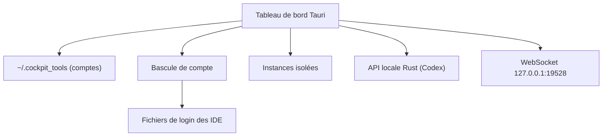

# jlcodes99/cockpit-tools

> Application de bureau qui gère plusieurs comptes d'IDE IA, suit leurs quotas et lance des instances parallèles.

## Le problème
Jongler entre plusieurs comptes Codex, Copilot, Cursor, Windsurf ou Kiro oblige à se déconnecter et reconnecter, sans vue sur les quotas restants.

## Ce que ça fait vraiment
Importe des comptes (OAuth, token, JSON), affiche les quotas par plateforme, bascule le compte actif en réécrivant les fichiers de login de chaque client et lance des instances isolées. Un service d'API local en Rust relaie Codex vers un pool de comptes. Un WebSocket local (port 19528) sert les plugins.

## Comment c'est branché


## Essayer
```bash
brew tap jlcodes99/cockpit-tools https://github.com/jlcodes99/cockpit-tools
brew install --cask cockpit-tools
# ou depuis les sources
npm install
npm run tauri dev
```

## Coût et pièges
Gratuit, mais il faut des comptes payants ou gratuits chez chaque éditeur. Les tokens du Grok CLI sont stockés en clair en local. La bascule de comptes peut contrevenir aux conditions d'usage des éditeurs.

## Ce que ce n'est pas
Pas un outil open source classique : la licence CC BY-NC-SA 4.0 interdit tout usage commercial, y compris interne en entreprise. Aucune licence n'est déclarée côté GitHub. Ce n'est pas un gestionnaire de secrets.

## Alternatives
- router-for-me/CLIProxyAPI : cité comme base de l'intégration API Codex, utilisable seul.
- CC Switch : cité pour les préréglages de fournisseurs.

## Pour toi
À ignorer en contexte pro : la licence non commerciale et le mainteneur unique l'excluent d'un usage en entreprise, et un profil MLOps n'a pas d'usage de la multi-gestion de comptes d'IDE.

