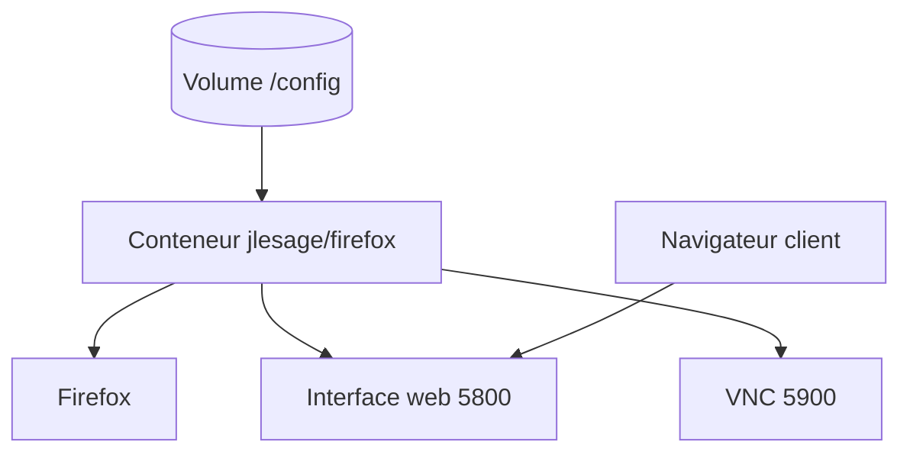

# jlesage/docker-firefox

> Docker container that serves Firefox in a web browser or over VNC, unofficial.

## The problem
Using an isolated browser, reachable remotely, without installing anything on the client side.

## What it actually does
Runs Firefox in a container and exposes its interface through the web (port 5800) or VNC (port 5900), with audio, clipboard, file manager and optional terminal. Configuration through environment variables (`DISPLAY_WIDTH`, `WEB_AUTHENTICATION`, `SECURE_CONNECTION`, `FF_KIOSK`). Settings persisted in the `/config` volume.

## How it is wired
Simplified diagram based on the fiche, no diagram provided.



## Trying it
```bash
docker run -d \
    --name=firefox \
    -p 5800:5800 \
    -v /docker/appdata/firefox:/config:rw \
    jlesage/firefox
```

## Cost and gotchas
Free. Unencrypted access by default: enable `SECURE_CONNECTION` and web authentication before any exposure. VNC password limited to 8 characters. README truncated in the material provided: the reverse proxy part was not read.

## What it is not
Not a Mozilla product: unofficial container. Not a browser automation tool.

## Alternatives
No alternative named in the README.

## For you
Worth watching: handy for an isolated test or watch browser in a Docker infrastructure, to be exposed only over HTTPS with authentication.
