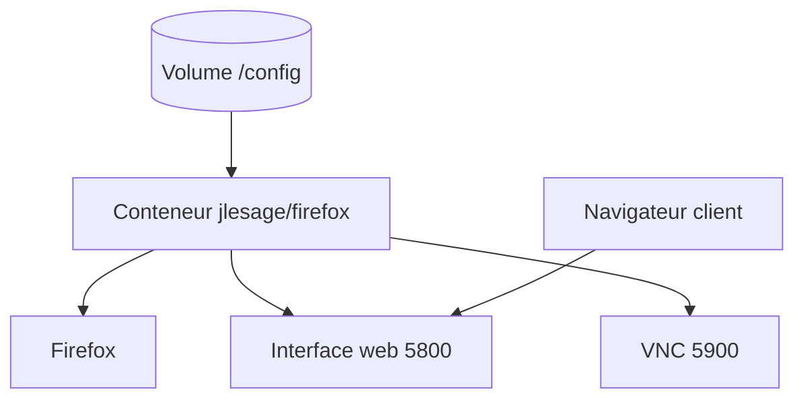

# jlesage/docker-firefox

> Conteneur Docker qui sert Firefox dans un navigateur web ou en VNC, non officiel.

## Le problème
Utiliser un navigateur isolé, accessible à distance, sans rien installer côté client.

## Ce que ça fait vraiment
Fait tourner Firefox dans un conteneur et expose son interface par le web (port 5800) ou VNC (port 5900), avec audio, presse-papiers, gestionnaire de fichiers et terminal en option. Configuration par variables d'environnement (`DISPLAY_WIDTH`, `WEB_AUTHENTICATION`, `SECURE_CONNECTION`, `FF_KIOSK`). Réglages persistés dans le volume `/config`.

## Comment c'est branché
Schéma simplifié d'après la fiche, sans diagramme fourni.



## Essayer
```bash
docker run -d \
    --name=firefox \
    -p 5800:5800 \
    -v /docker/appdata/firefox:/config:rw \
    jlesage/firefox
```

## Coût et pièges
Gratuit. Accès non chiffré par défaut : activer `SECURE_CONNECTION` et l'authentification web avant toute exposition. Mot de passe VNC limité à 8 caractères. README tronqué dans la matière fournie : la partie proxy inverse n'est pas lue.

## Ce que ce n'est pas
Pas un produit de Mozilla : conteneur non officiel. Pas un outil d'automatisation de navigateur.

## Alternatives
Aucune alternative nommée dans le README.

## Pour toi
À surveiller : pratique pour un navigateur isolé de test ou de veille dans une infra Docker, à n'exposer qu'en HTTPS avec authentification.

