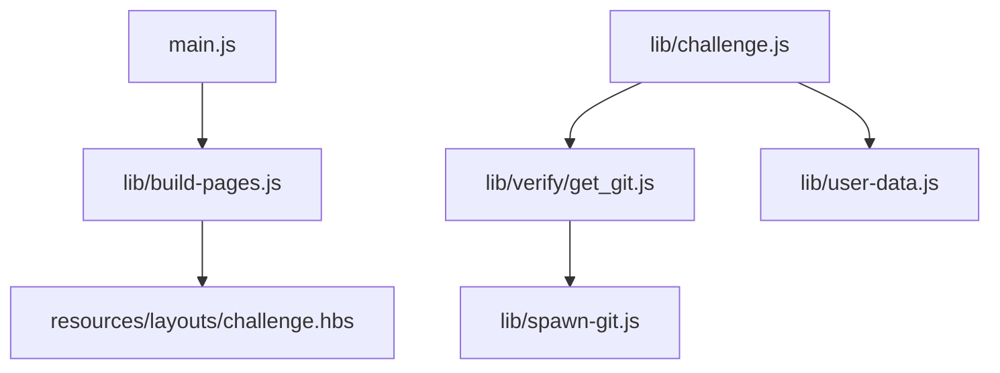

# jlord/git-it-electron

> Desktop application that teaches Git and GitHub through challenges with real repositories, for beginners.

## The problem
Learning Git on the command line without a practical guide leads to copied commands that are never understood.

## What it actually does
Electron application where each challenge asks you to use Git in a real terminal. The Verify button runs a checker that executes git and records progress. Pages are generated from `.hbs` templates and translated content (French, Spanish, Japanese, etc.). At the end, you have real repositories on your GitHub account.

## How it is wired

## Trying it
No documented command: download the executable from the releases page, unzip it and launch it, then click the first challenge.

## Cost and gotchas
Free. A GitHub account has to be created during the challenges, and Git and an editor must be installed. Last push in April 2024, the content may be dated.

## What it is not
Not a Git client. It emulates nothing: it checks what you actually do in your terminal.

## Alternatives
No alternative named in the README.

## For you
Ignore: you already master Git, and the app is only useful for training beginners.
