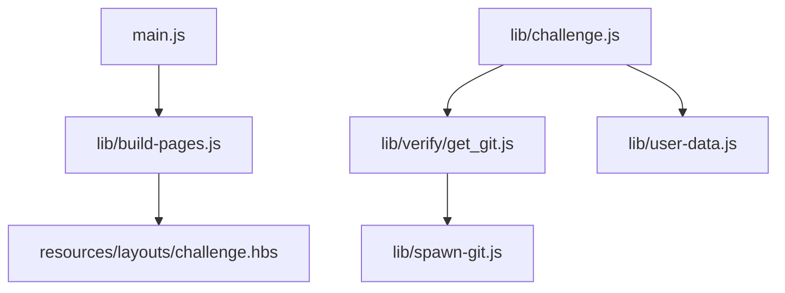

# jlord/git-it-electron

> Application de bureau qui enseigne Git et GitHub par des défis avec de vrais dépôts, pour débutants.

## Le problème
Apprendre Git en ligne de commande sans guide pratique mène à des commandes recopiées sans comprendre.

## Ce que ça fait vraiment
Application Electron dont chaque défi demande de manipuler Git dans un vrai terminal. Le bouton Verify lance un vérificateur qui exécute git et enregistre la progression. Les pages sont générées à partir de gabarits `.hbs` et de contenus traduits (français, espagnol, japonais, etc.). À la fin, on a de vrais dépôts sur son compte GitHub.

## Comment c'est branché

## Essayer
Aucune commande documentée : télécharger l'exécutable depuis la page des releases, le décompresser et le lancer, puis cliquer sur le premier défi.

## Coût et pièges
Gratuit. Un compte GitHub est à créer pendant les défis, et il faut installer Git et un éditeur. Dernier push en avril 2024, le contenu peut dater.

## Ce que ce n'est pas
Pas un client Git. Il n'émule rien : il vérifie ce que tu fais vraiment dans ton terminal.

## Alternatives
Aucune alternative nommée dans le README.

## Pour toi
Ignorer : tu maîtrises déjà Git, et l'app n'a d'intérêt que pour former des débutants.

