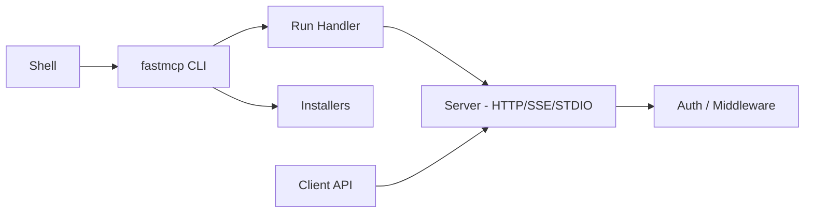

# jlowin/fastmcp

> Python framework for writing MCP servers, clients and applications from plain functions.

## The problem
Writing an MCP server by hand means handling schemas, validation, transports and authentication.

## What it actually does
An `@mcp.tool` decorator turns a Python function into an MCP tool, with generated schema and documentation. Three pillars: servers (tools, resources, prompts), clients (transport negotiation, authentication) and applications with an interactive interface. A `fastmcp` CLI runs a server and installs integrations (Claude Code, Claude Desktop, Cursor, mcp.json). The README claims to be behind 70% of MCP servers; figure not verified.

## How it is wired


## Trying it
```bash
uv add fastmcp
```
```python
from fastmcp import FastMCP
mcp = FastMCP("Demo 🚀")

@mcp.tool
def add(a: int, b: int) -> int:
    return a + b

if __name__ == "__main__":
    mcp.run()
```

## Cost and gotchas
Free. The README points to Prefect Horizon (an enterprise gateway, a product from the same publisher) for deployment at scale. Migration guides exist from FastMCP 2/3 and the MCP SDK.

## What it is not
Not an LLM client or an agent: it exposes or consumes MCP tools. The Horizon component is a separate offering.

## Alternatives
The official Python MCP SDK (into which FastMCP 1.0 was merged); `@prefecthq/fastmcp-ts` for TypeScript.

## For you
Adopt: it is the short path to expose your functions or data pipelines to an agent via MCP, with a publisher that actively maintains the project.
