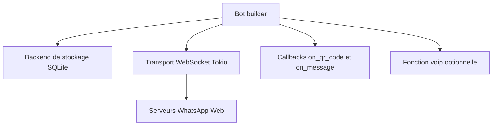

# jlucaso1/whatsapp-rust

> Asynchronous Rust library to drive a WhatsApp Web account: pairing, encrypted messages, calls.

## The problem
Writing a WhatsApp bot or client in Rust means reimplementing the WhatsApp Web protocol and its end-to-end encryption.

## What it actually does
Pairing by QR or code, persistent sessions, encrypted direct and group messages, media, reactions, groups, communities, statuses. Audio and video calls exist through the optional `voip` feature. Storage, transport, HTTP client and runtime are replaceable; by default SQLite, Tokio WebSocket, ureq. Windows/macOS support is not qualified.

## How it is wired

Simplified diagram based on the sheet, no diagram provided.

## Trying it
```bash
# Cargo.toml : whatsapp-rust = "0.7" et tokio (macros, rt-multi-thread, signal)
# puis le code Bot::builder() du README (QR à scanner, réponse "pong" à "ping")
```

## Cost and gotchas
Free, but the README warns that use may violate Meta's terms and lead to account suspension. Unofficial client, hence exposed to any protocol change.

## What it is not
Neither an official client nor a WhatsApp Business API. No support guarantee outside Linux.

## Alternatives
- baileyrs: Baileys-compatible API, JavaScript side backed by Rust/WASM.
- whatsapp-rust-bridge: Rust/WASM utilities for JavaScript.

## For you
Ignore: little link to data or MLOps, and the risk of an account ban outweighs the appeal of automating WhatsApp.
