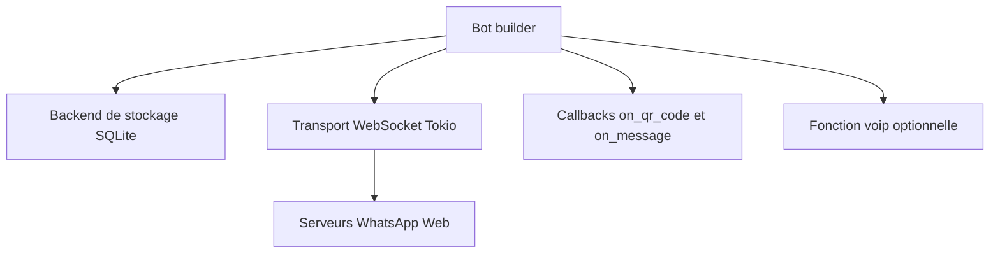

# jlucaso1/whatsapp-rust

> Bibliothèque Rust asynchrone pour piloter un compte WhatsApp Web : appairage, messages chiffrés, appels.

## Le problème
Écrire un bot ou un client WhatsApp en Rust oblige à réimplémenter le protocole de WhatsApp Web et son chiffrement de bout en bout.

## Ce que ça fait vraiment
Appairage par QR ou code, sessions persistantes, messages directs et de groupe chiffrés, médias, réactions, groupes, communautés, statuts. Les appels audio et vidéo existent via la fonctionnalité optionnelle `voip`. Stockage, transport, client HTTP et runtime sont remplaçables ; par défaut SQLite, WebSocket Tokio, ureq. Le support Windows/macOS n'est pas qualifié.

## Comment c'est branché

Schéma simplifié d'après la fiche, sans diagramme fourni.

## Essayer
```bash
# Cargo.toml : whatsapp-rust = "0.7" et tokio (macros, rt-multi-thread, signal)
# puis le code Bot::builder() du README (QR à scanner, réponse "pong" à "ping")
```

## Coût et pièges
Gratuit, mais le README prévient que l'usage peut violer les conditions de Meta et entraîner la suspension du compte. Client non officiel, donc exposé à tout changement du protocole.

## Ce que ce n'est pas
Ni un client officiel ni une API WhatsApp Business. Pas de garantie de support hors Linux.

## Alternatives
- baileyrs : API compatible Baileys, côté JavaScript adossé à Rust/WASM.
- whatsapp-rust-bridge : utilitaires Rust/WASM pour JavaScript.

## Pour toi
Ignorer : peu de lien avec la data ou le MLOps, et le risque de bannissement de compte pèse plus que l'intérêt d'automatiser WhatsApp.

