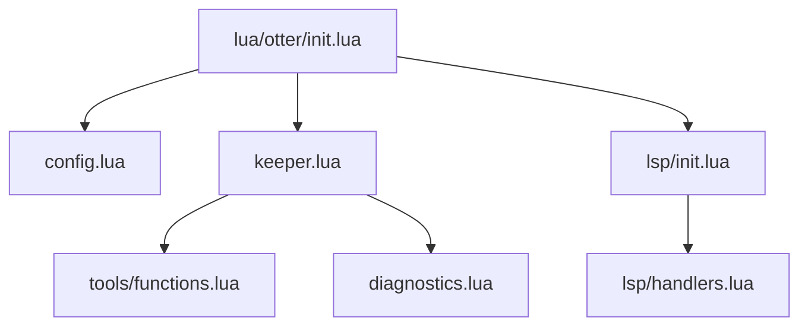

# jmbuhr/otter.nvim

> Neovim plugin that provides LSP completion and diagnostics for code embedded in quarto or markdown documents.

## The problem
In a quarto notebook mixing Python and R, no LSP server understands the code in the blocks.

## What it actually does
Creates hidden buffers, one per language, that keep only the block's code and blank lines elsewhere. An internal LSP server redirects requests (hover, definition, completion, rename, references) to the right buffer, then translates the response. Activated with `otter.activate()`.

## How it is wired
Diagram based on the code's diagram.


## Trying it
```bash
# lazy.nvim : { 'jmbuhr/otter.nvim', dependencies = { 'nvim-treesitter/nvim-treesitter' }, opts = {} }
make test
```

## Cost and gotchas
Free. Requires Neovim 0.10 or later and treesitter parsers. It works on a single file at a time and formatting goes through conform.nvim.

## What it is not
Not a Python or R language server: it relies on yours. Cross-notebook renames are not propagated.

## Alternatives
No alternative named in the README (conform.nvim is mentioned for formatting).

## For you
Worth watching if you work on quarto notebooks in Neovim: it gives code blocks a real LSP.
