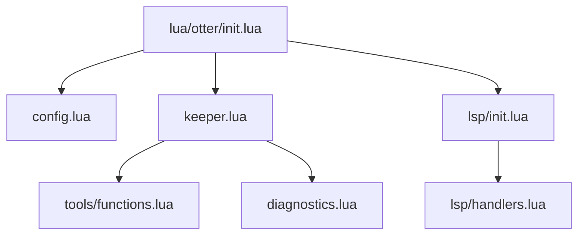

# jmbuhr/otter.nvim

> Plugin Neovim qui offre complétion et diagnostics LSP au code embarqué dans des documents quarto ou markdown.

## Le problème
Dans un notebook quarto avec Python et R mêlés, aucun serveur LSP ne comprend le code des blocs.

## Ce que ça fait vraiment
Crée des tampons cachés, un par langage, qui ne gardent que le code du bloc et des lignes vides ailleurs. Un serveur LSP interne redirige les requêtes (hover, définition, complétion, renommage, références) vers le bon tampon puis traduit la réponse. Activation avec `otter.activate()`.

## Comment c'est branché
Schéma d'après le diagramme du code.


## Essayer
```bash
# lazy.nvim : { 'jmbuhr/otter.nvim', dependencies = { 'nvim-treesitter/nvim-treesitter' }, opts = {} }
make test
```

## Coût et pièges
Gratuit. Neovim 0.10 ou plus et des parseurs treesitter. Il fonctionne sur un seul fichier à la fois et le formatage passe par conform.nvim.

## Ce que ce n'est pas
Pas un serveur de langage Python ou R : il s'appuie sur les tiens. Les renommages inter-notebooks ne sont pas propagés.

## Alternatives
Aucune alternative nommée dans le README (conform.nvim est cité pour le formatage).

## Pour toi
À surveiller si tu travailles sur des notebooks quarto dans Neovim : il donne un vrai LSP aux blocs de code.

