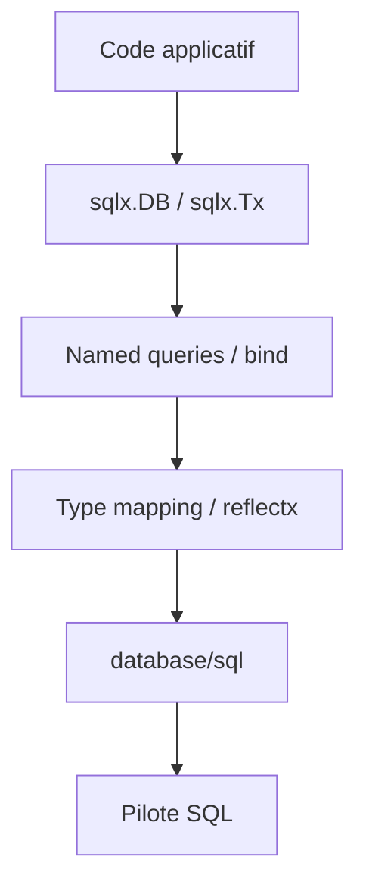

# jmoiron/sqlx

> Go extensions to `database/sql` for mapping SQL rows to structs.

## The problem
With `database/sql`, every column has to be scanned by hand and named parameters do not exist. The code quickly becomes verbose.

## What it actually does
It adds `sqlx.DB`, `Tx` and `Stmt`, which wrap the standard types without changing their interface.
Rows are loaded into structs, maps or slices. `Get` and `Select` go straight from the query to the result.
It supports named parameters (`:name`), batch inserts and `BindDriver` for unknown drivers.

## How it is wired


## Trying it
```bash
go get github.com/jmoiron/sqlx
```

## Cost and gotchas
It is free. With ambiguous column headers (`SELECT a.id, b.id`), you need `AS` aliases.

## What it is not
It is not an ORM: no migrations, no query generation. The code is in Go, not Python. The last push dates from 2024-08-15.

## Alternatives
The README names no alternative repository.

## For you
Ignore: a stable Go building block, but outside your Python/ML ecosystem and nearly dormant.
