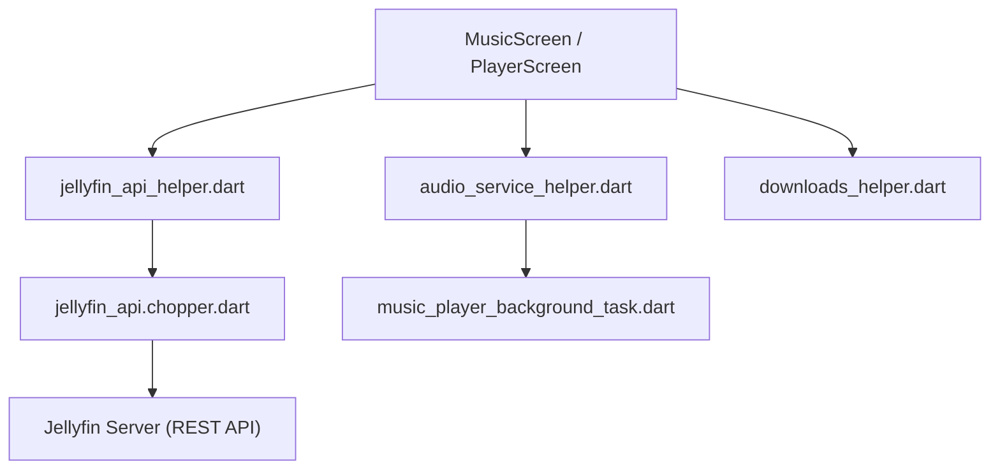

# jmshrv/finamp

> Free cross-platform music player to stream and download your library from a Jellyfin server.

## The problem
Listen to your own music hosted on Jellyfin with a polished mobile app, offline included.

## What it actually does
Flutter application (Android, iOS, desktop): gapless playback, offline downloads, transcoding to limit data, lyrics, ReplayGain normalization, dynamic colors, Android Auto and CarPlay, listening tracking. A Jellyfin server is required.

## How it is wired
Diagram taken from the one provided.



## Trying it
```bash
yay -S finamp
```

## Cost and gotchas
Free, but unusable without a Jellyfin server. On Windows, first install a self-signed certificate for the `.msix` file.

## What it is not
Not a streaming service and it provides no music. Navidrome and Lyra work, without active support.

## Alternatives
No alternative named in the README.

## For you
Ignore for your data / AI / MLOps work: a music player, only useful if you already host Jellyfin.
