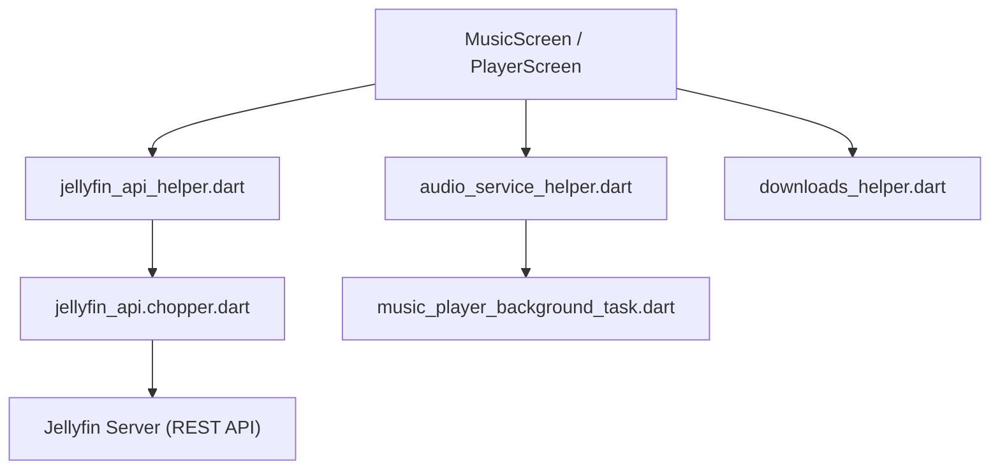

# jmshrv/finamp

> Lecteur de musique libre multiplateforme pour streamer et télécharger sa bibliothèque depuis un serveur Jellyfin.

## Le problème
Écouter sa propre musique hébergée sur Jellyfin avec une application mobile soignée, hors ligne compris.

## Ce que ça fait vraiment
Application Flutter (Android, iOS, bureau) : lecture sans coupure, téléchargement hors ligne, transcodage pour limiter les données, paroles, normalisation ReplayGain, couleurs dynamiques, Android Auto et CarPlay, suivi d'écoute. Un serveur Jellyfin est indispensable.

## Comment c'est branché
Schéma d'après le diagramme fourni.



## Essayer
```bash
yay -S finamp
```

## Coût et pièges
Gratuit, mais inutilisable sans serveur Jellyfin. Sur Windows, installer d'abord un certificat auto-signé pour le fichier `.msix`.

## Ce que ce n'est pas
Pas un service de streaming et il ne fournit aucune musique. Navidrome et Lyra fonctionnent, sans support actif.

## Alternatives
Aucune alternative nommée dans le README.

## Pour toi
À ignorer pour ton travail data / IA / MLOps : un lecteur de musique, utile seulement si tu héberges déjà Jellyfin.

