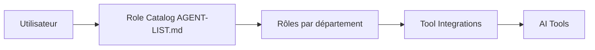

# jnMetaCode/agency-agents-zh

> Chinese library of 328 ready-to-copy AI agent roles for coding tools.

## The problem
A "you are an expert" prompt stays vague. Structured roles (rules, method, deliverables) reusable from one tool to another are missing.

## What it actually does
Provides Markdown role files by department (engineering, marketing, finance, security, GIS, games...), including 67 originals for the Chinese market, the rest translated from msitarzewski/agency-agents. `convert.sh` and `install.sh` scripts adapt them to 20 tools. It is not a runtime: the architecture described from the code confirms it.

## How it is wired


## Trying it
```bash
./scripts/install.sh --tool claude-code
cp -r marketing/*.md ~/.claude/agents/
npm install agency-agents-zh
```

## Cost and gotchas
Free, but the README warns that installing everything dilutes matching (Cursor, Trae): pick 10 to 20 roles. Hermes' Discord mode caps commands at 8,000 characters.

## What it is not
Not an orchestrator (that is the sibling project agency-orchestrator). Content in Chinese. Figures diverge (328 roles in the README, 277 in the code analysis). README full of sponsor banners.

## Alternatives
- msitarzewski/agency-agents: the original English version.
- agency-orchestrator: to make the roles collaborate.
- superpowers-zh: working methodology (TDD, review).

## For you
Watch: useful as a reservoir of role prompts, but in Chinese, heterogeneous and with no data/MLOps value of its own; pick from it occasionally.
