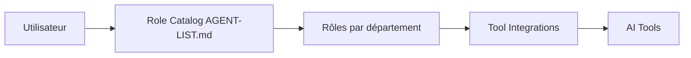

# jnMetaCode/agency-agents-zh

> Bibliothèque chinoise de 328 rôles d'agents IA prêts à copier dans des outils de codage.

## Le problème
Un prompt « tu es un expert » reste vague. Il manque des rôles structurés (règles, méthode, livrables) réutilisables d'un outil à l'autre.

## Ce que ça fait vraiment
Fournit des fichiers Markdown de rôles par département (ingénierie, marketing, finance, sécurité, SIG, jeux…), dont 67 originaux pour le marché chinois, le reste traduit de msitarzewski/agency-agents. Des scripts `convert.sh` et `install.sh` les adaptent à 20 outils. Ce n'est pas un runtime : l'architecture décrite d'après le code le confirme.

## Comment c'est branché


## Essayer
```bash
./scripts/install.sh --tool claude-code
cp -r marketing/*.md ~/.claude/agents/
npm install agency-agents-zh
```

## Coût et pièges
Gratuit, mais le README signale que tout installer dilue le matching (Cursor, Trae) : choisir 10 à 20 rôles. Le mode Discord de Hermes plafonne à 8 000 caractères de commandes.

## Ce que ce n'est pas
Pas un orchestrateur (c'est le projet frère agency-orchestrator). Contenu en chinois. Les chiffres divergent (328 rôles au README, 277 dans l'analyse du code). README plein de bandeaux de sponsors.

## Alternatives
- msitarzewski/agency-agents : version anglaise d'origine.
- agency-orchestrator : pour faire collaborer les rôles.
- superpowers-zh : méthodologie de travail (TDD, revue).

## Pour toi
À surveiller : utile comme réservoir de prompts-rôles, mais en chinois, hétérogène et sans valeur data/MLOps propre ; pioche ponctuellement.

