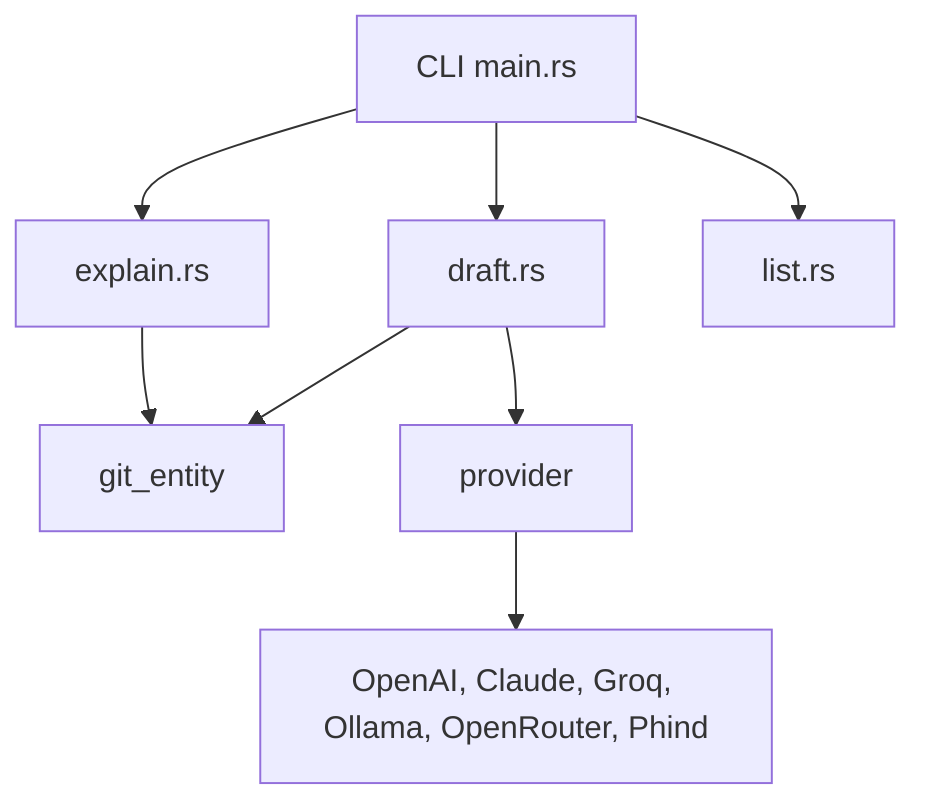

# jnsahaj/lumen

> Terminal diff viewer and code review tool, written in Rust, for people who live in git.

## The problem
Reading a `git diff` or a pull request in a raw terminal is painful, and annotating changes forces you to leave the tool.

## What it actually does
Lumen displays side-by-side diffs with tree-sitter highlighting, for local changes, commits, branches or GitHub PRs. You can annotate a selection, a block or a file, then send the annotations to standard output, for example to a coding agent. Optional AI commands (commit message, explanation, git command) require a configured provider. It works with Git and Jujutsu.

## How it is wired


## Trying it
```bash
brew install jnsahaj/lumen/lumen
# ou
cargo install lumen

lumen diff
lumen diff main..feature/A
lumen diff --pr 123
lumen diff main..feature --stacked
```

## Cost and gotchas
The viewer is free and local. The AI features require an API key (`lumen configure`) and the provider's bill is on you; Ollama lets you stay local.

## What it is not
It is not only an AI tool: diff review works without a provider. It is not a replacement for GitHub for collective review; annotations stay local unless exported.

## Alternatives
No alternative is named in the README (lazygit is cited only as an integration).

## For you
Adopt: a single binary that improves diff review and the dialogue with a coding agent, for a near-zero trial cost.
