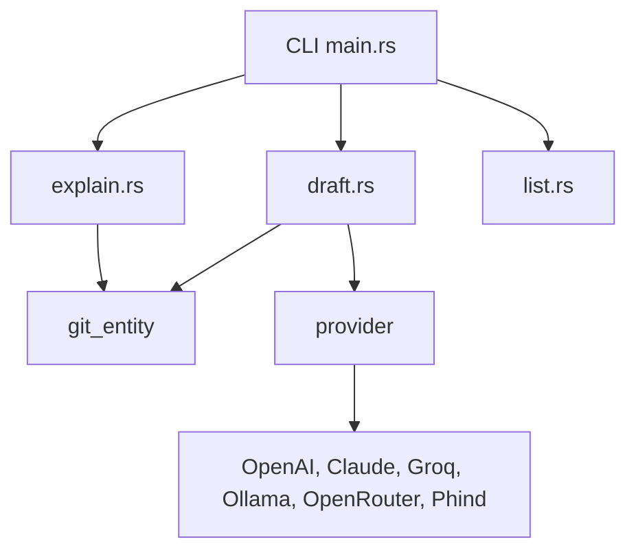

# jnsahaj/lumen

> Visionneuse de diff et revue de code en terminal, écrite en Rust, pour qui vit dans git.

## Le problème
Relire un `git diff` ou une pull request dans un terminal brut est pénible, et annoter les changements oblige à quitter l'outil.

## Ce que ça fait vraiment
Lumen affiche les diffs côte à côte avec coloration tree-sitter, pour les changements locaux, commits, branches ou PR GitHub. On peut annoter une sélection, un bloc ou un fichier, puis renvoyer les annotations sur la sortie standard, par exemple à un agent de code. Des commandes IA optionnelles (message de commit, explication, commande git) demandent un fournisseur configuré. Il fonctionne avec Git et Jujutsu.

## Comment c'est branché


## Essayer
```bash
brew install jnsahaj/lumen/lumen
# ou
cargo install lumen

lumen diff
lumen diff main..feature/A
lumen diff --pr 123
lumen diff main..feature --stacked
```

## Coût et pièges
Le visionneur est gratuit et local. Les fonctions IA exigent une clé d'API (`lumen configure`) et la facture du fournisseur est à ta charge ; Ollama permet de rester local.

## Ce que ce n'est pas
Ce n'est pas qu'un outil IA : la revue de diff marche sans fournisseur. Ce n'est pas un remplaçant de GitHub pour la revue collective ; les annotations restent locales sauf export.

## Alternatives
Aucune alternative n'est nommée dans le README (lazygit est cité seulement comme intégration).

## Pour toi
À adopter : un seul binaire qui améliore la revue de diffs et le dialogue avec un agent de code, pour un coût d'essai quasi nul.

