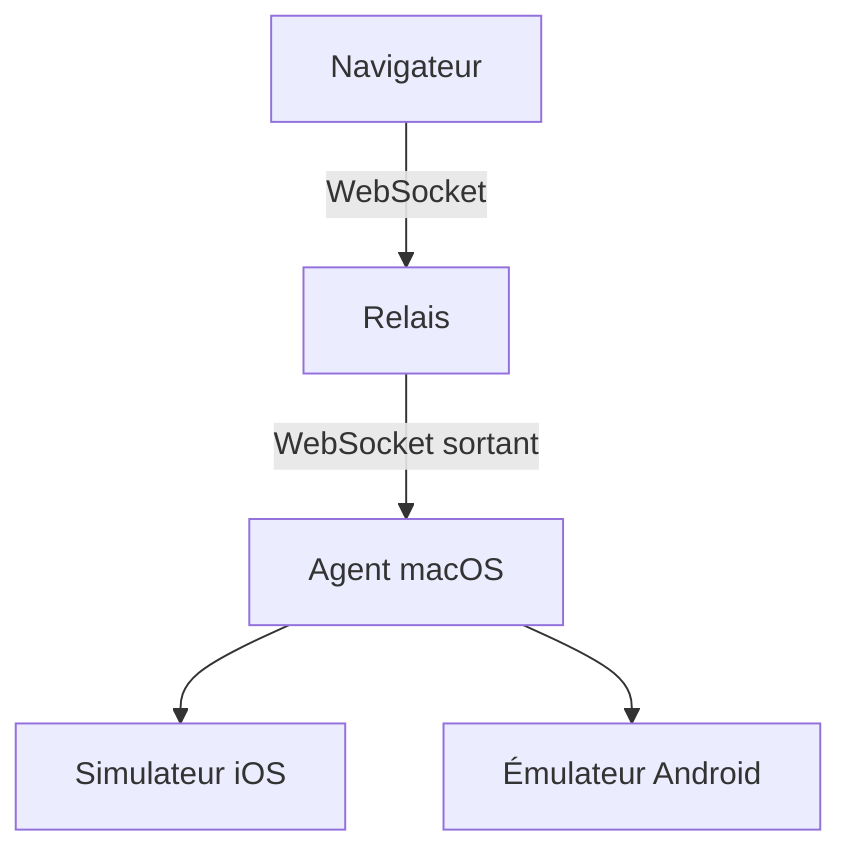

# jo-duchan/tapflow

> Self-hosted alternative to Appetize and BrowserStack: iOS simulators and Android emulators controllable in a browser.

## The problem
Testing a mobile app requires Xcode, Android Studio or a paid cloud where you upload your builds.

## What it actually does
A relay (Linux or Mac) serves the dashboard. A macOS agent drives simulators and emulators, connects outbound to the relay and injects iOS touch without WebDriverAgent. The browser displays an H.264 stream at about 30 frames per second. You can drop in builds, record sessions, replay a YAML flow and plug in an MCP server for agents (experimental).

## How it is wired


## Trying it
```bash
npm install -g tapflow
tapflow setup
tapflow start
tapflow doctor
```

## Cost and gotchas
Free, MIT. The agents require a Mac (macOS 26 or 27, matching Xcode). The relay is the trust boundary: only expose it with authentication. Project at v0.x.

## What it is not
Not a phone farm nor a replacement for Xcode. Appium and WebDriverAgent are out of scope.

## Alternatives
- Appetize: paid cloud service, builds sent to a third party.
- BrowserStack: same trade-off, with a subscription.

## For you
Ignore: a mobile QA tool, unrelated to data, AI or MLOps, despite its experimental MCP server.
