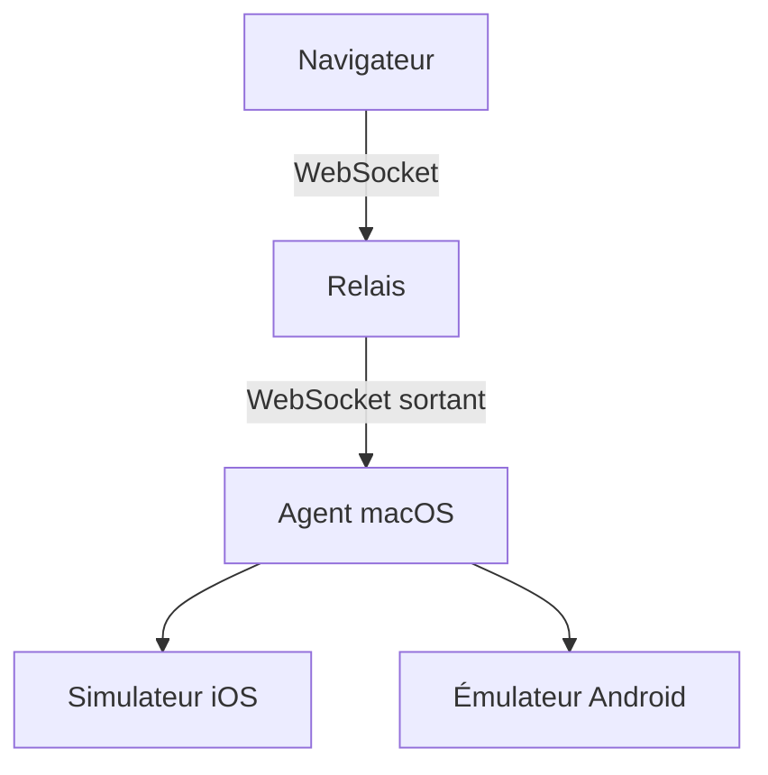

# jo-duchan/tapflow

> Alternative auto-hébergée à Appetize et BrowserStack : simulateurs iOS et émulateurs Android pilotables dans un navigateur.

## Le problème
Tester une appli mobile suppose Xcode, Android Studio ou un cloud payant où l'on envoie ses builds.

## Ce que ça fait vraiment
Un relais (Linux ou Mac) sert le tableau de bord. Un agent macOS pilote simulateurs et émulateurs, se connecte au relais en sortie et injecte le toucher iOS sans WebDriverAgent. Le navigateur affiche le flux H.264 d'environ 30 images par seconde. On peut déposer des builds, enregistrer des sessions, rejouer un flux YAML et brancher un serveur MCP pour agents (expérimentaux).

## Comment c'est branché


## Essayer
```bash
npm install -g tapflow
tapflow setup
tapflow start
tapflow doctor
```

## Coût et pièges
Gratuit, MIT. Les agents exigent un Mac (macOS 26 ou 27, Xcode correspondant). Le relais est la frontière de confiance : ne l'expose qu'avec authentification. Projet en v0.x.

## Ce que ce n'est pas
Pas un parc de téléphones ni un remplaçant d'Xcode. Appium et WebDriverAgent sont hors périmètre.

## Alternatives
- Appetize : service cloud payant, builds envoyés chez un tiers.
- BrowserStack : même compromis, avec abonnement.

## Pour toi
À ignorer : outil de QA mobile, sans lien avec data, IA ou MLOps, malgré son serveur MCP expérimental.

