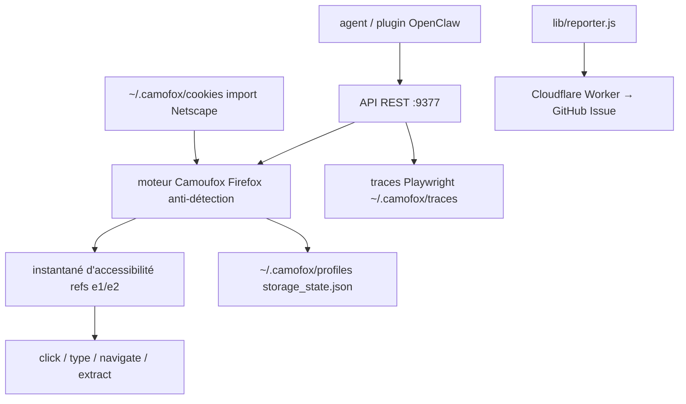

# jo-inc/camofox-browser

> Browsing REST API for agents, built on Camoufox, with accessibility snapshots and stable refs.

## The problem
An agent that needs to browse the real web gets blocked: Playwright is detected, headless Chrome is fingerprinted, and stealth plugins become the signature themselves.
Sending raw HTML to the model costs a fortune in tokens.

## What it actually does
Exposes Camoufox — a Firefox whose fingerprints are spoofed at the C++ level (`navigator.hardwareConcurrency`, WebGL, AudioContext, screen geometry, WebRTC) — behind a REST API designed for agents.
Returns accessibility snapshots advertised as about 90% smaller than HTML, with stable refs `e1`, `e2` for clicking and typing; `offset` pagination on large pages.
Per-user isolated sessions, cookie and localStorage persistence in `~/.camofox/profiles/`, Netscape cookie import, proxy with GeoIP (locale, timezone, geolocation aligned with the exit IP), sticky sessions in backconnect mode.
Extras: YouTube transcripts via yt-dlp, search macros (`@google_search`…), structured extraction by JSON Schema with `x-ref`, per-session Playwright traces, JSON logs, OpenAPI docs at `/docs`.

## How it is wired


## Trying it
```bash
git clone https://github.com/jo-inc/camofox-browser && cd camofox-browser
npm install && npm start
npx @askjo/camofox-browser
openclaw plugins install @askjo/camofox-browser
make up
make fetch
docker run -p 9377:9377 -e CAMOFOX_API_KEY="your-generated-key" -v ~/.camofox/cookies:/home/node/.camofox/cookies:ro camofox-browser
openssl rand -hex 32
export CAMOFOX_CRASH_REPORT_ENABLED=false
```

## Cost and gotchas
Free; the first start downloads Camoufox (~300 MB) and the idle memory footprint is advertised at ~40 MB.
Crash telemetry is enabled by default and opens GitHub issues automatically, with described anonymization and hash verification of the endpoint; `CAMOFOX_CRASH_REPORT_ENABLED=false` turns it off. Do not run `docker build` directly: go through `make up`. Without `CAMOFOX_API_KEY`, cookie import is refused with a 403.

## What it is not
Not a browser for humans: the output is an accessibility tree, not a rendered page.
Not Chromium: Chromium-only Playwright features, like `recordVideo`, do not exist — hence the traces.
Not a guaranteed bypass: "bypasses most bot detection" remains a README claim, and anti-detection is not authorization to access.

## Alternatives
- Camoufox: the underlying engine, if you do not need the REST API.
- Playwright, headless Chrome: cited as the approaches that get blocked.

## For you
Keep it handy for agentic scraping; first check the compliance of the sites you target.
