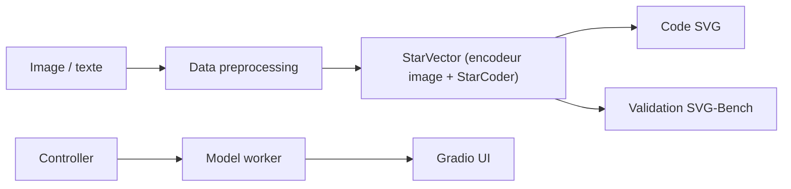

# joanrod/star-vector

> Multimodal model that generates SVG code from an image or text.

## The problem
Classic vectorizers trace curves without understanding the image, producing artifacts and using few SVG primitives.

## What it actually does
StarVector projects the image into visual tokens and generates the SVG code directly with a StarCoder-type LLM (1B and 8B versions). It handles image→SVG and text→SVG. The repo provides training (Deepspeed for 1B, FSDP for 8B), the SVG-Bench benchmark (10 datasets), validation through Hugging Face or a vLLM fork, and a Gradio demo.

## How it is wired


## Trying it
```bash
git clone https://github.com/joanrod/star-vector.git
cd star-vector
conda create -n starvector python=3.11.3 -y
conda activate starvector
pip install -e .
```

## Cost and gotchas
A GPU is required; vLLM acceleration goes through a specific fork. Training the 8B needs 8 GPUs.

## What it is not
Does not work for natural images or illustrations: it is trained for icons, logos, diagrams, charts and fonts.

## Alternatives
- VTracer, Potrace, AutoTrace: classic vectorizers compared in the README table.

## For you
Worth watching: useful for vectorizing icons and diagrams, but limited to that domain and GPU-hungry; classic vectorizers remain simpler.
