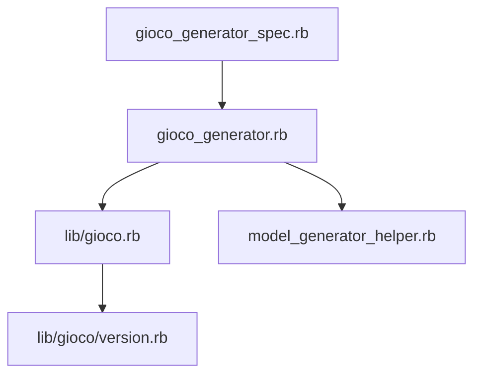

# joaomdmoura/gioco

> Rails gem that adds gamification (badges, levels, points) to Active Record models.

## The problem
Implementing badges, levels and points by hand in a Rails app.

## What it actually does
Based on the code: a small gem with `lib/gioco.rb` and a Rails generator `gioco_generator.rb` that creates the models through a helper. A single spec validates the generator. The README is a work-in-progress version 2.0 RC, with no further detail.

## How it is wired


## Trying it
```ruby
gem "gioco"
```
```bash
bundle install
```

## Cost and gotchas
Rails and Active Record required. Last push in January 2023 and no license: reuse is uncertain.

## What it is not
Not a turnkey gamification service: it is a model generator. The old version is on the 1.1.1 branch.

## Alternatives
No alternative named in the README.

## For you
Ignore: poorly documented Rails gem, with no license and inactive since 2023.
