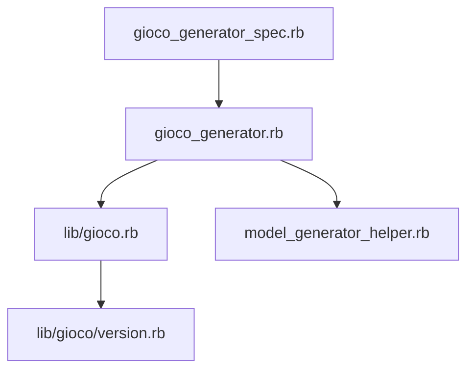

# joaomdmoura/gioco

> Gem Rails pour ajouter de la gamification (badges, niveaux, points) aux modèles Active Record.

## Le problème
Implémenter badges, niveaux et points à la main dans une appli Rails.

## Ce que ça fait vraiment
D'après le code : un petit gem avec `lib/gioco.rb` et un générateur Rails `gioco_generator.rb` qui crée les modèles par un helper. Une seule spec valide le générateur. Le README est une version 2.0 RC en cours de travail, sans autre détail.

## Comment c'est branché


## Essayer
```ruby
gem "gioco"
```
```bash
bundle install
```

## Coût et pièges
Rails et Active Record requis. Dernier push en janvier 2023 et licence absente : réutilisation incertaine.

## Ce que ce n'est pas
Pas un service de gamification clé en main : c'est un générateur de modèles. L'ancienne version est sur la branche 1.1.1.

## Alternatives
Aucune alternative nommée dans le README.

## Pour toi
Ignorer : gem Rails peu documenté, sans licence et inactif depuis 2023.

