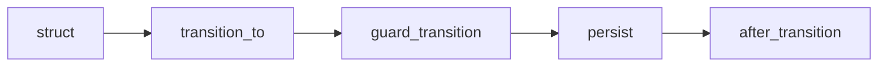

# joaomdmoura/machinery

> State machine library for Elixir, with Phoenix integration, for Elixir developers.

## The problem
Handling a model's state transitions (created, partial, completed) by hand leads to scattered, fragile code.

## What it actually does
A DSL declares states and transitions (`"*"` wildcards). `Machinery.transition_to/3,4` changes the state. Optional callbacks: `guard_transition`, `before_transition`, `after_transition`, `persist`, `log_transition`.

## How it is wired


## Trying it
```elixir
{:machinery, "~> 1.1.0"}
Machinery.transition_to(your_struct, YourStateMachine, "next_state")
```

## Cost and gotchas
Free. Last push May 2024, a single maintainer.

## What it is not
Not a distributed workflow engine: it is an in-memory state machine around structs.

## Alternatives
No alternative named in the README.

## For you
Ignore: Elixir is outside your data/AI profile, and the project is barely active.
