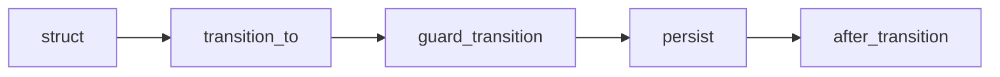

# joaomdmoura/machinery

> Bibliothèque de machines à états pour Elixir, avec intégration Phoenix, pour développeurs Elixir.

## Le problème
Gérer les transitions d'états d'un modèle (créé, partiel, terminé) à la main mène à du code éparpillé et fragile.

## Ce que ça fait vraiment
Un DSL déclare états et transitions (jokers `"*"`). `Machinery.transition_to/3,4` change l'état. Des callbacks facultatifs : `guard_transition`, `before_transition`, `after_transition`, `persist`, `log_transition`.

## Comment c'est branché


## Essayer
```elixir
{:machinery, "~> 1.1.0"}
Machinery.transition_to(your_struct, YourStateMachine, "next_state")
```

## Coût et pièges
Gratuit. Dernier push mai 2024, un seul mainteneur.

## Ce que ce n'est pas
Pas un moteur de workflow distribué : c'est une machine à états en mémoire autour de structs.

## Alternatives
Aucune alternative nommée dans le README.

## Pour toi
À ignorer : Elixir hors de ton profil data/IA, et projet peu actif.

