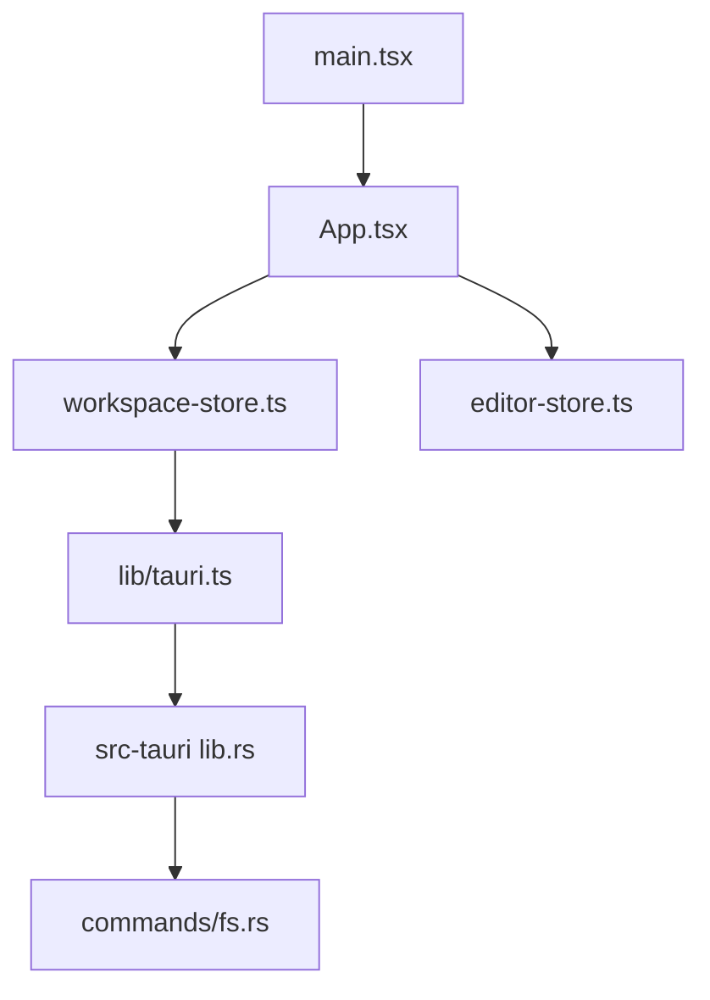

# joelbqz/writer-computer

> Lightweight Markdown editor for macOS that edits plain-text note folders in place.

## The problem
Opening large Markdown note vaults (Obsidian, wikis, docs) in heavy editors is slow.

## What it actually does
Tauri v2 application (React, Zustand, CodeMirror, Rust) of about 6 MB. It opens a folder, edits files on disk, respects `.gitignore` files, handles multiple windows and renders tables and Mermaid diagrams. It publishes signed macOS releases.

## How it is wired


## Trying it
```bash
vp install
vp dev
vp check
vp test
```

## Cost and gotchas
Free, macOS only. Usage telemetry exists, disabled by default and not compiled into builds made from a clone. Development requires the `vp` tool.

## What it is not
Not a knowledge-management tool with a graph: it is a file editor. No Windows or Linux version.

## Alternatives
The README compares it to Apple Notes and Obsidian for speed.

## For you
Keep an eye on it: a good editor for your Markdown notes if you are on a Mac, a recent project by a single person.
