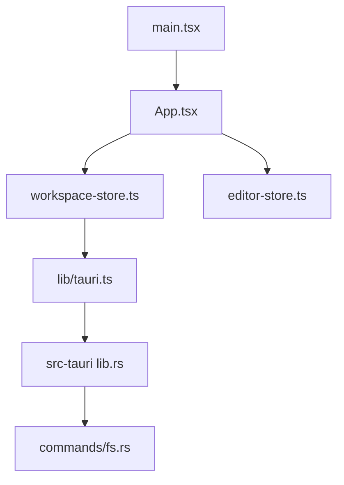

# joelbqz/writer-computer

> Éditeur Markdown léger pour macOS qui édite en place les dossiers de notes en texte brut.

## Le problème
Ouvrir de gros coffres de notes Markdown (Obsidian, wikis, docs) dans des éditeurs lourds est lent.

## Ce que ça fait vraiment
Application Tauri v2 (React, Zustand, CodeMirror, Rust) d'environ 6 Mo. Elle ouvre un dossier, édite les fichiers sur le disque, respecte les `.gitignore`, gère plusieurs fenêtres et affiche tableaux et diagrammes Mermaid. Elle publie des versions macOS signées.

## Comment c'est branché


## Essayer
```bash
vp install
vp dev
vp check
vp test
```

## Coût et pièges
Gratuit, macOS seulement. Une télémétrie d'usage existe, désactivée par défaut et non compilée dans les builds faits depuis un clone. Le développement exige l'outil `vp`.

## Ce que ce n'est pas
Ce n'est pas un outil de gestion de connaissances avec graphe : c'est un éditeur de fichiers. Pas de version Windows ou Linux.

## Alternatives
Le README compare à Apple Notes et Obsidian pour la vitesse.

## Pour toi
À surveiller : bon éditeur pour tes notes en Markdown si tu es sur Mac, projet récent d'une seule personne.

