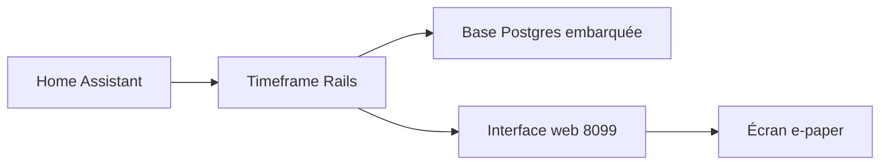

# joelhawksley/timeframe

> Family dashboard for an e-paper display: calendar, weather and home automation pulled from Home Assistant.

## The problem
Seeing schedule, weather and the state of the house at a glance without a bright screen in the living room.

## What it actually does
Rails application that reads calendars, weather and sensors from Home Assistant, then displays them on an e-paper screen (Visionect, experimental). `sensor.timeframe_*` entities define the alerts in the screen corners. Tokens in event descriptions (`timeframe-banner`, `timeframe-icon`) adjust the display.

## How it is wired
Simplified diagram based on the fiche, no diagram provided.


## Trying it
```bash
docker compose up -d --build
bundle install
bin/rails s
bin/rails test
```

## Cost and gotchas
Free, but you need a Home Assistant instance and a long-lived access token. The `/data` volume must be kept: it contains the database and the secret key. License present but not recognized by GitHub.

## What it is not
Not an AI or data tool. Not a standalone dashboard: without Home Assistant it shows nothing. The `timeframe-countdown` token is only honored by the hosted application.

## Alternatives
No alternative named in the README.

## For you
Ignore: a personal home automation project, unrelated to data or MLOps, and the license needs clarifying.
