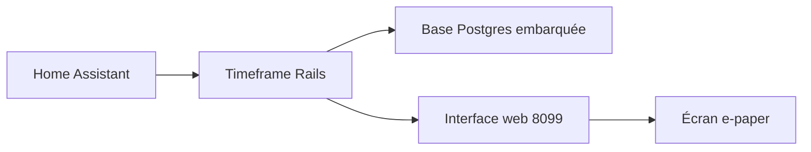

# joelhawksley/timeframe

> Tableau de bord familial pour écran e-paper : calendrier, météo et domotique tirés de Home Assistant.

## Le problème
Voir d'un coup d'œil agenda, météo et état de la maison sans écran lumineux dans le salon.

## Ce que ça fait vraiment
Application Rails qui lit les calendriers, la météo et les capteurs de Home Assistant, puis les affiche sur un écran e-paper (Visionect expérimental). Des entités `sensor.timeframe_*` définissent les alertes en coins d'écran. Des jetons dans la description des événements (`timeframe-banner`, `timeframe-icon`) règlent l'affichage.

## Comment c'est branché
Schéma simplifié d'après la fiche, sans diagramme fourni.


## Essayer
```bash
docker compose up -d --build
bundle install
bin/rails s
bin/rails test
```

## Coût et pièges
Gratuit, mais il faut une instance Home Assistant et un jeton d'accès longue durée. Le volume `/data` doit être conservé : il contient la base et la clé secrète. Licence présente mais non reconnue par GitHub.

## Ce que ce n'est pas
Pas un outil d'IA ni de data. Pas un tableau de bord autonome : sans Home Assistant il ne montre rien. Le jeton `timeframe-countdown` n'est honoré que par l'application hébergée.

## Alternatives
Aucune alternative nommée dans le README.

## Pour toi
À ignorer : projet domotique personnel, sans rapport avec la data ou le MLOps, et licence à clarifier.

