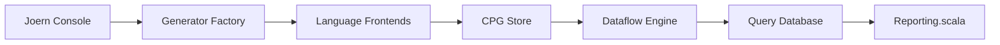

# joernio/joern

> Code analysis platform that builds code property graphs, for vulnerability researchers.

## The problem
Hunting for flaws across several languages requires a unified, queryable representation of the code.

## What it actually does
A per-language frontend generates a code property graph (CPG), stored in a graph database. You query it with a Scala-based query language in a console. Dataflow engine, security scanners and a query database (QueryDB).

## How it is wired


## Trying it
```bash
wget https://github.com/joernio/joern/releases/latest/download/joern-install.sh
chmod +x ./joern-install.sh
sudo ./joern-install.sh
joern
```

## Cost and gotchas
JDK 21 required; gcc/g++ optional for C/C++ headers. Docker version available.

## What it is not
Not just a turnkey scanner: it is a query workshop. The README states that other JDK versions "might" work, untested.

## Alternatives
- None cited in the README.

## For you
Worth watching: relevant for auditing AI or pipeline code, but it demands an investment in Scala queries.
