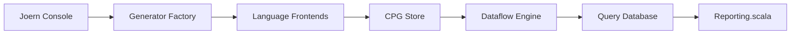

# joernio/joern

> Plateforme d'analyse de code qui construit des graphes de propriétés de code, pour chercheurs en vulnérabilités.

## Le problème
Chercher des failles à travers plusieurs langages exige une représentation unifiée du code, interrogeable.

## Ce que ça fait vraiment
Un frontend par langage génère un graphe de propriétés de code (CPG), stocké dans une base de graphes. On l'interroge avec un langage de requêtes en Scala dans une console. Moteur de flux de données, scanners de sécurité et base de requêtes (QueryDB).

## Comment c'est branché


## Essayer
```bash
wget https://github.com/joernio/joern/releases/latest/download/joern-install.sh
chmod +x ./joern-install.sh
sudo ./joern-install.sh
joern
```

## Coût et pièges
JDK 21 requis ; gcc/g++ optionnels pour les en-têtes C/C++. Version Docker disponible.

## Ce que ce n'est pas
Pas un scanner clé en main seulement : c'est un atelier à requêtes. Le README précise que d'autres versions de JDK « pourraient » fonctionner sans test.

## Alternatives
- Aucune citée dans le README.

## Pour toi
À surveiller : pertinent pour auditer du code d'IA ou de pipelines, mais demande un investissement en requêtes Scala.

