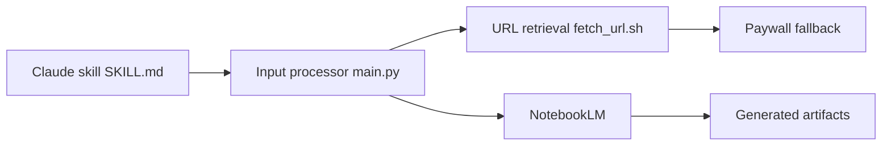

# joeseesun/qiaomu-anything-to-notebooklm

> Claude Code skill that converts various content into a podcast, PPT or mind map via NotebookLM.

## The problem
Manually turning articles, videos and files into summary materials in NotebookLM.

## What it actually does
Detects the input type (URL, file, search), retrieves or converts the content, uploads it to NotebookLM and generates the requested format. A `--deep-analysis` mode asks 12 questions in three rounds. Includes a cascading paywall bypass (6 levels), a WeChat MCP and a Feishu MCP.

## How it is wired


## Trying it
```bash
cd ~/.claude/skills/
git clone https://github.com/joeseesun/qiaomu-anything-to-notebooklm
cd qiaomu-anything-to-notebooklm
./install.sh
notebooklm login
```

## Cost and gotchas
Requires a Google NotebookLM account; Get笔记 keys for podcasts. The paywall bypass feature raises legal and ethical issues: the README limits it to personal use.

## What it is not
Not a standalone tool: it depends on NotebookLM and its unofficial CLI. Last push in April 2026.

## Alternatives
Cites Bypass Paywalls Clean, markitdown and notebooklm-py as building blocks or inspirations.

## For you
Ignore: depends on a closed service and bypasses paywalls; prefer RAG or summarization pipelines that you control.
