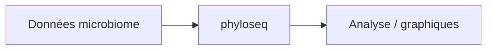

# joey711/phyloseq

> Bioconductor R package for analysing and visualising microbiome census data.

## The problem
Microbiome data (OTUs, taxonomy, trees, metadata) is scattered and hard to analyse reproducibly.

## What it actually does
The README is thin: installation via BiocManager, links to the home page, the FAQ, the tracker and the papers (PLoS ONE 2013, Shiny-phyloseq, a critique of rarefaction). The detail of the functions is not documented in this README.

## How it is wired


## Trying it
```r
if(!requireNamespace("BiocManager")){
  install.packages("BiocManager")
}
BiocManager::install("phyloseq")
```

## Cost and gotchas
Free. No licence on the catalogue side. 769 open issues: maintenance status uncertain.

## What it is not
It is not a general-purpose tool; it targets the microbiome. It is not a tutorial.

## Alternatives
No alternative named in the README.

## For you
Watch: a reference in the microbiome field for R, but with no declared licence and outside the core of data/AI.
