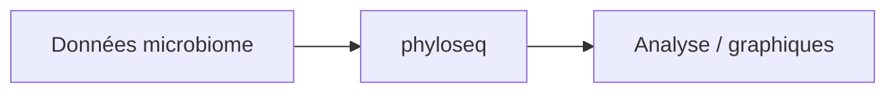

# joey711/phyloseq

> Package R Bioconductor pour analyser et visualiser des données de recensement de microbiome.

## Le problème
Les données de microbiome (OTU, taxonomie, arbres, métadonnées) sont éparpillées et difficiles à analyser de façon reproductible.

## Ce que ça fait vraiment
Le README est mince : installation via BiocManager, liens vers la page d'accueil, la FAQ, le tracker et les articles (PLoS ONE 2013, Shiny-phyloseq, critique de la raréfaction). Le détail des fonctions n'est pas documenté dans ce README.

## Comment c'est branché


## Essayer
```r
if(!requireNamespace("BiocManager")){
  install.packages("BiocManager")
}
BiocManager::install("phyloseq")
```

## Coût et pièges
Gratuit. Licence absente côté catalogue. 769 issues ouvertes : suivi de maintenance incertain.

## Ce que ce n'est pas
Ce n'est pas un outil généraliste ; il vise le microbiome. Ce n'est pas un tutoriel.

## Alternatives
Aucune alternative nommée dans le README.

## Pour toi
À surveiller : référence du domaine microbiome en R, mais sans licence déclarée et hors du cœur data/IA.

