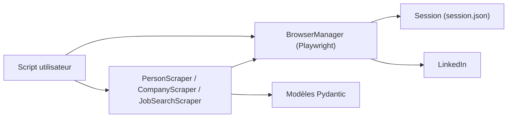

# joeyism/linkedin_scraper

> Asynchronous Python library to extract profiles, companies and job postings from LinkedIn with Playwright.

## The problem
Programmatically retrieve LinkedIn data that has no open API.

## What it actually does
Since v3, it drives a Playwright browser with a saved authenticated session, and exposes scrapers (`PersonScraper`, `CompanyScraper`, `JobSearchScraper`, `CompanyPostsScraper`) that return Pydantic models. It includes progress callbacks and typed exceptions. v3 is not compatible with v2 (Selenium); the GitDiagram schema still describes v2.

## How it is wired


## Trying it
```bash
pip install linkedin-scraper
playwright install chromium
python3 samples/create_session.py
python3 samples/scrape_person.py
```

## Cost and gotchas
Requires a logged-in LinkedIn account; risk of rate limiting or account blocking. The README limits use to education and refers to LinkedIn's terms.

## What it is not
Not an official API: scraping may violate LinkedIn's terms of use. GPL-3.0 license.

## Alternatives
No alternative named in the README.

## For you
Ignore: risk of terms-of-use violations and a blocked account, GPL license, and everything it provides depends on a site that keeps changing; go through declared data sources instead.
