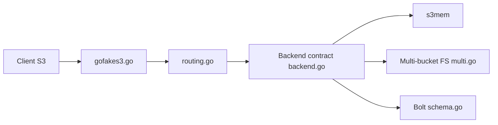

# johannesboyne/gofakes3

> Fake S3 server in Go for locally testing code that reads from or writes to S3.

## The problem
Testing code that accesses S3 without an AWS account or costs, quickly and reproducibly.

## What it actually does
S3-compatible HTTP server: a router sends operations to a backend of your choice (in-memory with versions, single- or multi-bucket filesystem, Bolt). Handles multipart uploads. Used with the AWS SDKs (v1, v2, JavaScript) by pointing the endpoint at the server, with path-style addressing recommended.

## How it is wired


## Trying it
```bash
docker pull johannesboyne/gofakes3
go get github.com/johannesboyne/gofakes3
```
Then create `s3mem.New()` and `gofakes3.New(backend)` in your test, as in the README example.

## Cost and gotchas
Free. Part of the S3 API is not implemented and breaking changes are expected. No need for correctness, performance or security, according to the author.

## What it is not
Not production storage: a fake S3 built for tests.

## Alternatives
MinIO (more complete, described as "not similar but powerful") and andrewgaul/s3proxy, cited in the README.

## For you
Adopt for integration tests of data pipelines that read S3: lightweight, local, no cloud account; switch to MinIO if the need goes beyond the covered API.
