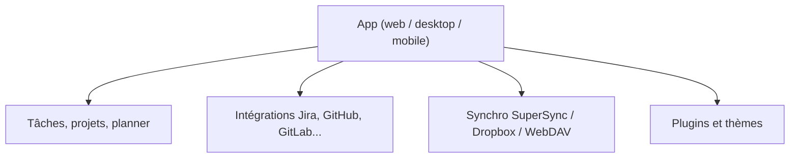

# johannesjo/super-productivity

> Private, offline, open source to-do list, time tracker and daily planner.

## The problem
Tracking your tasks and work time without entrusting your data to a cloud account.

## What it actually does
Tasks with subtasks, projects, tags, scheduling, Kanban boards and Eisenhower matrix. Timer (Pomodoro, Flowtime), break reminders, timesheets. Integrates Jira, GitHub, GitLab, Linear and others. Sync via SuperSync (encrypted, self-hostable), Dropbox or WebDAV. Linux, macOS, Windows, Android, iOS, browser.

## How it is wired


## Trying it
```bash
# Aucune commande documentée dans ce README : télécharger depuis le wiki ou ouvrir la web app.
```

## Cost and gotchas
Free, no account. The web version has limits compared to desktop. The README does not describe SuperSync hosting options.

## What it is not
Not a team tool nor a full project manager. It is not the same as a service synced by default: you choose where your data goes.

## Alternatives
No named alternative in the README.

## For you
Watch: useful if you want local time tracking tied to your tickets; unrelated to data / AI work, nothing urgent.
