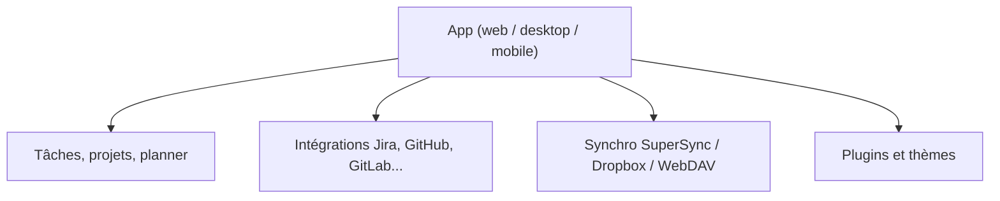

# johannesjo/super-productivity

> Liste de tâches, suivi du temps et planificateur quotidien, privé, hors ligne et open source.

## Le problème
Suivre ses tâches et son temps de travail sans confier ses données à un compte cloud.

## Ce que ça fait vraiment
Tâches avec sous-tâches, projets, étiquettes, planning, tableaux Kanban et matrice d'Eisenhower. Minuteur (Pomodoro, Flowtime), rappels de pause, feuilles de temps. Intègre Jira, GitHub, GitLab, Linear et d'autres. Synchro via SuperSync (chiffré, auto-hébergeable), Dropbox ou WebDAV. Linux, macOS, Windows, Android, iOS, navigateur.

## Comment c'est branché


## Essayer
```bash
# Aucune commande documentée dans ce README : télécharger depuis le wiki ou ouvrir la web app.
```

## Coût et pièges
Gratuit, sans compte. La version web a des limites par rapport au bureau. Le README ne décrit pas les options d'hébergement de SuperSync.

## Ce que ce n'est pas
Pas un outil d'équipe ni un gestionnaire de projet complet. Ce n'est pas la même chose qu'un service synchronisé par défaut : tu choisis où vont tes données.

## Alternatives
Aucune alternative nommée dans le README.

## Pour toi
À surveiller : sert si tu cherches un suivi du temps local lié à tes tickets ; sans lien avec le travail data / IA, rien d'urgent.

