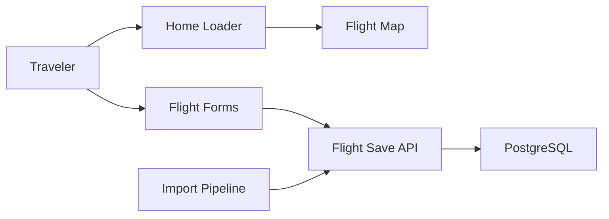

# johanohly/AirTrail

> Self-hosted web application to track your flights, see them on a map and get statistics from them.

## The problem
Keeping your flight history out of closed applications, with a map and statistics.

## What it actually does
Interactive world map, history, statistics, multi-user with sharing and OAuth, dark mode, responsive interface. Import from MyFlightRadar24, App in the Air, JetLog, TripIt, Flighty, byAir, JetLovers and OpenFlights. SvelteKit stack with PostgreSQL. Installation is described in the online documentation, not in the README.

## How it is wired


## Trying it
```bash
# Aucune commande dans le README : voir la documentation d'installation.
```

## Cost and gotchas
Free; you need to host PostgreSQL. Airline logos are provided for identification purposes, with no guarantee of rights.

## What it is not
Not a real-time flight tracker: it is a history journal. GPL-3.0.

## Alternatives
No alternative named in the README (the services listed are import sources).

## For you
Ignore on the professional side: nice for personal use but unrelated to professional data/AI.
