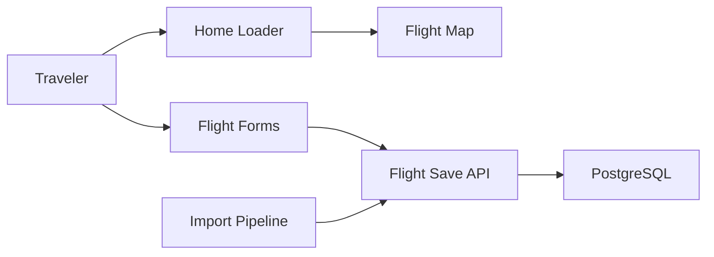

# johanohly/AirTrail

> Application web auto-hébergée pour suivre ses vols, les voir sur une carte et en tirer des statistiques.

## Le problème
Garder l'historique de ses vols hors des applications fermées, avec carte et statistiques.

## Ce que ça fait vraiment
Carte du monde interactive, historique, statistiques, multi-utilisateurs avec partage et OAuth, mode sombre, interface responsive. Import depuis MyFlightRadar24, App in the Air, JetLog, TripIt, Flighty, byAir, JetLovers et OpenFlights. Stack SvelteKit avec PostgreSQL. Installation décrite dans la documentation en ligne, pas dans le README.

## Comment c'est branché


## Essayer
```bash
# Aucune commande dans le README : voir la documentation d'installation.
```

## Coût et pièges
Gratuit ; il faut héberger PostgreSQL. Les logos de compagnies sont fournis à titre d'identification, sans garantie de droits.

## Ce que ce n'est pas
Pas un suivi de vols en temps réel : c'est un journal d'historique. GPL-3.0.

## Alternatives
Aucune alternative nommée dans le README (les services listés sont des sources d'import).

## Pour toi
À ignorer côté pro : sympathique pour un usage personnel mais sans lien avec la data/IA professionnelle.

