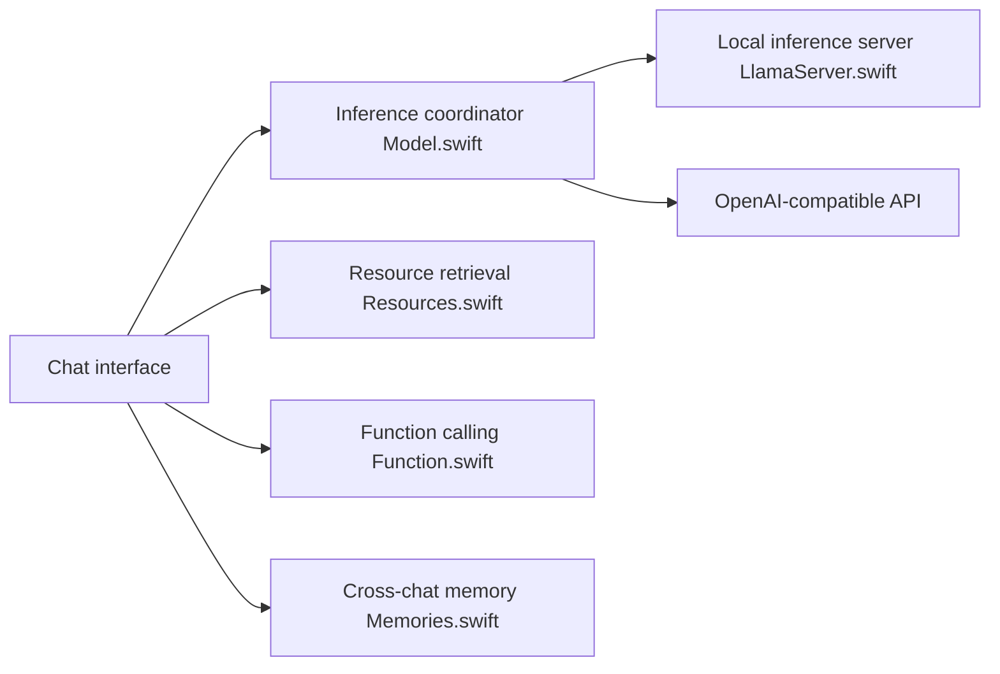

# johnbean393/Sidekick

> macOS app for chatting with a local LLM, grounded in your files, folders and websites.

## The problem
Querying your documents with an LLM without sending your data to the cloud means building a RAG stack yourself.

## What it actually does
Swift app with an embedded `llama.cpp` engine (GGUF models, speculative decoding). "Experts" group indexed files, folders and websites (RAG) with clickable citations; web search, looped function calling, Deep Research (50-80 pages), cross-conversation memory, an editing Canvas, image generation (macOS 15.2+ with Apple Intelligence). API keys can be used for OpenAI, Anthropic, etc.

## How it is wired


## Trying it
```bash
brew install --cask arcadi4/tap/sidekick
./setup.sh
```
The second is the developer command; then open the project in Xcode.

## Cost and gotchas
Apple Silicon Mac, 8 GB of RAM minimum. Local models have to be downloaded. Remote models consume your keys. The last push dates from May 2026.

## What it is not
Not cross-platform. The "unlimited resources" promise rests on RAG, with no guarantee on answer quality.

## Alternatives
- FreeChat: the project Sidekick is inspired by.

## For you
Worth watching if you are on a Mac and want a local chat over your documents; otherwise prefer a backend exposed as an API.
