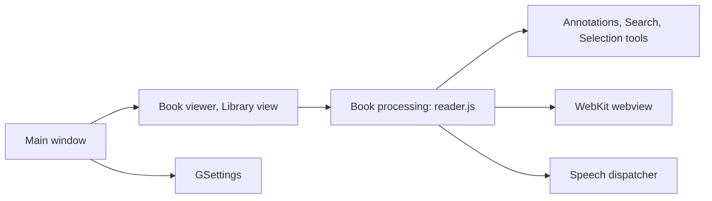

# johnfactotum/foliate

> E-book reader for the GNOME desktop (GTK4, libadwaita).

## The problem
Reading e-books on Linux with polished rendering and real reading features.

## What it actually does
The README is short: runtime dependencies (gjs, GTK4, libadwaita, WebKitGTK 6.0), optional dependencies (hyphenation rules, `speech-dispatcher`, `tracker`) and installation modes. According to the architecture described from the code, the app offers annotations, search, text-to-speech, themes, OPDS catalogs and selection tools; rendering goes through WebKit. These elements are not detailed in the README.

## How it is wired


## Trying it
```bash
git clone --recurse-submodules https://github.com/johnfactotum/foliate.git
gjs -m src/main.js
meson setup build
sudo ninja -C build install
sudo snap install foliate
```

## Cost and gotchas
Free; Git submodules are mandatory. When launched from source with `gjs`, settings are not saved unless the schema is compiled. The README states gjs ≥ 1.82, the generated graph cites 1.76: follow the README.

## What it is not
It is not cross-platform: a GNOME/Linux tool. It is not a text extraction or analysis tool.

## Alternatives
No alternative named in the README.

## For you
Ignore: e-book reader for a Linux desktop, outside the data/AI/MLOps scope.
