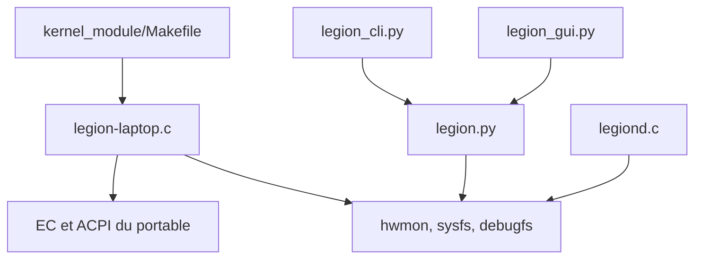

# johnfanv2/LenovoLegionLinux

> Kernel driver and tools to control fans and power modes of Lenovo Legion laptops on Linux.

## The problem
Lenovo tools (Vantage, Legion Zone) exist only on Windows: on Linux, the fan curve and power limits remain inaccessible.

## What it actually does
A kernel module (`legion-laptop.c`) talks to the EC and ACPI, then exposes hwmon, sysfs and debugfs. On top of it: a CLI and a PyQt GUI for the fan curve (10 points), power mode, fast charging, the Fn lock. A `legiond` daemon applies AC/battery presets.

## How it is wired


## Trying it
```bash
git clone https://github.com/johnfanv2/LenovoLegionLinux.git
cd LenovoLegionLinux/kernel_module
make
sudo make reloadmodule
```

## Cost and gotchas
Free, but you must compile a kernel module (kernel headers, DKMS, Secure Boot). No guarantee: the project is a hobby not affiliated with Lenovo, and features depend on the model and BIOS.

## What it is not
Not a multi-brand tool, nor usable under WSL or Windows. Not an official kernel driver (merging is only a goal). Not all Legion models are supported.

## Alternatives
- LenovoLegionToolkit: for Windows.
- LegionFanControl: for Windows.

## For you
Ignore: it is laptop hardware tuning, unrelated to data, AI or MLOps work, unless you happen to have a Legion on Linux.
