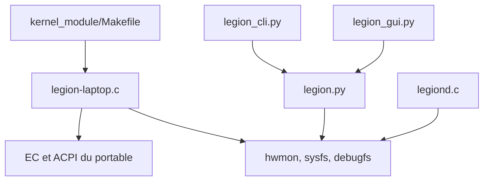

# johnfanv2/LenovoLegionLinux

> Pilote noyau et outils pour piloter ventilateurs et modes de puissance des portables Lenovo Legion sous Linux.

## Le problème
Les outils Lenovo (Vantage, Legion Zone) n'existent que sous Windows : sous Linux, courbe de ventilation et limites de puissance restent inaccessibles.

## Ce que ça fait vraiment
Un module noyau (`legion-laptop.c`) parle à l'EC et à l'ACPI, puis expose hwmon, sysfs et debugfs. Par-dessus : un CLI et une GUI PyQt pour la courbe de ventilation (10 points), le mode de puissance, la charge rapide, le verrou Fn. Un démon `legiond` applique des préréglages secteur/batterie.

## Comment c'est branché


## Essayer
```bash
git clone https://github.com/johnfanv2/LenovoLegionLinux.git
cd LenovoLegionLinux/kernel_module
make
sudo make reloadmodule
```

## Coût et pièges
Gratuit, mais il faut compiler un module noyau (en-têtes du noyau, DKMS, Secure Boot). Aucune garantie : le projet est un passe-temps non affilié à Lenovo, les fonctions dépendent du modèle et du BIOS.

## Ce que ce n'est pas
Pas un outil multi-marques ni utilisable sous WSL ou Windows. Pas un pilote officiel du noyau (la fusion n'est qu'un objectif). Tous les modèles Legion ne sont pas pris en charge.

## Alternatives
- LenovoLegionToolkit : pour Windows.
- LegionFanControl : pour Windows.

## Pour toi
Ignorer : c'est du réglage matériel de portable, sans lien avec le travail data, IA ou MLOps, sauf si tu as justement un Legion sous Linux.

