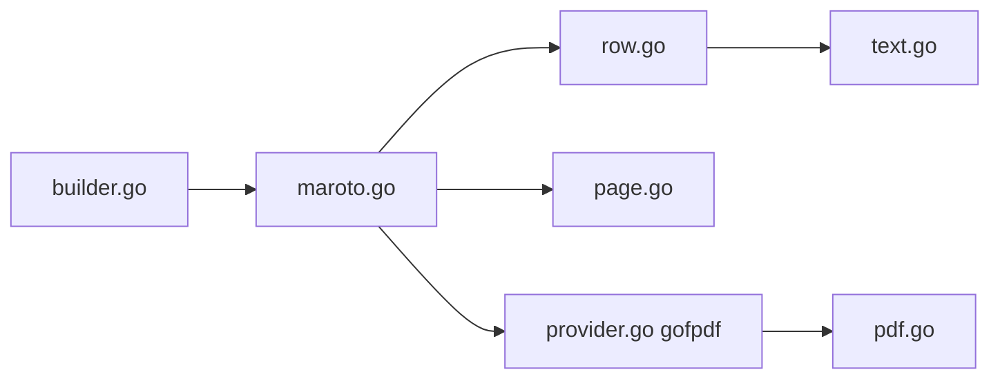

# johnfercher/maroto

> Go library for generating PDFs with a Bootstrap-like row/column grid.

## The problem
Producing PDFs (invoices, reports) in Go forces you to position every element by hand.

## What it actually does
You compose a document from rows, columns and components (text, image, barcode), with automatic pagination and repeated headers and footers. The rendering engine relies on gofpdf. The repository also provides custom fonts, image caching, code generation and a metrics decorator.

## How it is wired


## Trying it
```bash
go get github.com/johnfercher/maroto/v2@v2.4.2
```

## Cost and gotchas
Free. The README is short: detailed usage is in the external documentation.

## What it is not
Not an HTML-to-PDF converter: you build the document in code. Outside the Go ecosystem.

## Alternatives
No named alternative; v1 still exists in a branch.

## For you
Keep an eye on it: handy for generating PDF reports from a Go service, but pointless if your stack is Python.
