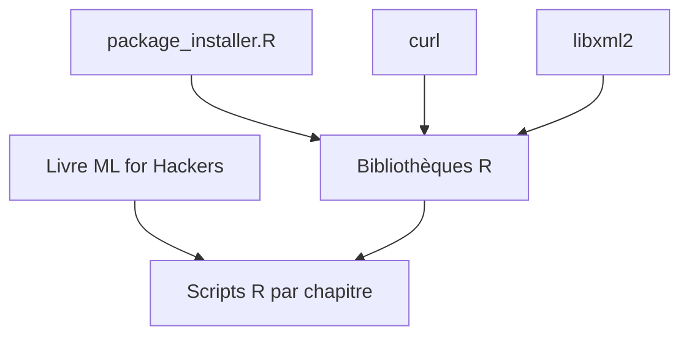

# johnmyleswhite/ML_for_Hackers

> R code for the book "Machine Learning for Hackers" (2012), for those following along with the book.

## The problem
A reader of the book wants the code examples, because the printed excerpts are partial.

## What it actually does
Gathers the book's examples in R, with comments added since publication. A `package_installer.R` script installs the required libraries. `RCurl` and `XML` require installing curl and libxml2 beforehand.

## How it is wired
Simplified diagram based on the sheet, no diagram provided.



## Trying it
```bash
sudo RScript package_installer.R
```
Or, in the R console: `source("package_installer.R")`.

## Cost and gotchas
Free. Repository frozen since 2019, with no license: reuse of the code is legally unclear. R packages may no longer install identically.

## What it is not
Not a standalone course: without the book, the code has little context. No data included, according to the README.

## Alternatives
- No alternative named in the README.

## For you
Ignore: R examples from 2012, with no license or maintenance; to learn ML today, an up-to-date Python resource is a better choice.
