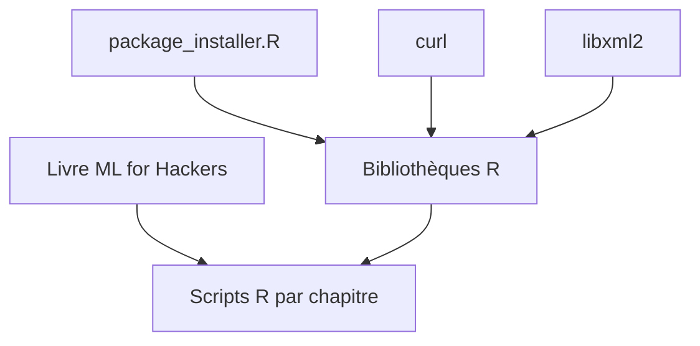

# johnmyleswhite/ML_for_Hackers

> Code R du livre « Machine Learning for Hackers » (2012), pour ceux qui suivent l'ouvrage.

## Le problème
Un lecteur du livre veut les exemples de code, car les extraits imprimés sont partiels.

## Ce que ça fait vraiment
Regroupe les exemples du livre en R, avec des commentaires ajoutés depuis la publication. Un script `package_installer.R` installe les bibliothèques nécessaires. `RCurl` et `XML` demandent d'installer curl et libxml2 au préalable.

## Comment c'est branché
Schéma simplifié d'après la fiche, sans diagramme fourni.



## Essayer
```bash
sudo RScript package_installer.R
```
Ou, dans la console R : `source("package_installer.R")`.

## Coût et pièges
Gratuit. Dépôt figé depuis 2019, sans licence : réutilisation du code juridiquement floue. Les paquets R peuvent ne plus s'installer à l'identique.

## Ce que ce n'est pas
Pas un cours autonome : sans le livre, le code a peu de contexte. Pas de données incluses, d'après le README.

## Alternatives
- Aucune alternative nommée dans le README.

## Pour toi
À ignorer : exemples R de 2012, sans licence ni maintenance ; pour apprendre le ML aujourd'hui, une ressource à jour en Python est un meilleur choix.

