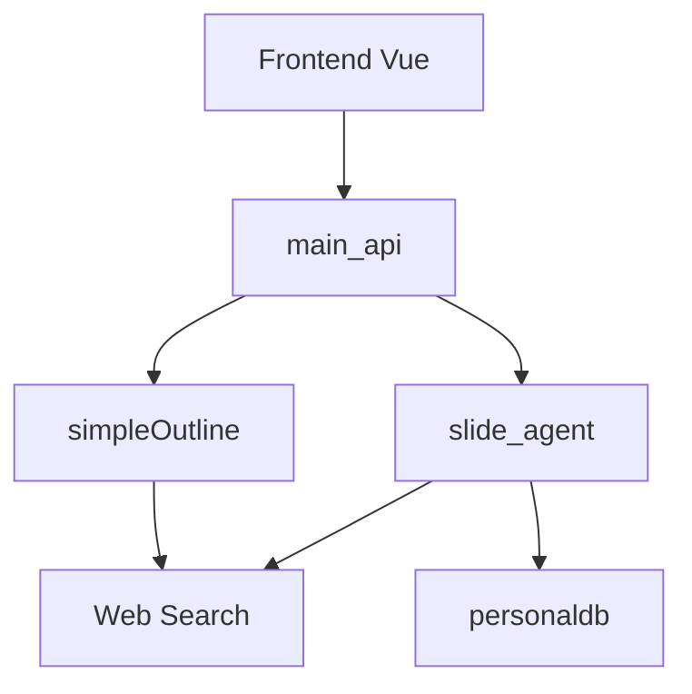

# johnson7788/TrainPPTAgent

> AI presentation generator: from an idea to an outline, then page by page, with web search.

## The problem
Writing an outline and then the content of each slide from sources takes hours of manual research.

## What it actually does
- Vue.js, Vite and TypeScript front end; Python (FastAPI) back end with A2A, ADK and MCP.
- Generates a Markdown outline, then the content page by page as a stream, using a chosen model.
- Can search the web, search for images, or query a knowledge base of uploaded files.
- GRPO training is announced; its code lives in another repository.

## How it is wired


## Trying it
```bash
cp env_template.txt .env
python start.py
cd backend
pip install -r requirements.txt
python start_backend.py
cd frontend
npm install
npm run dev
docker compose up
```

## Cost and gotchas
Model API keys (commercial or local) at your expense; several `.env` files, one per service. The front end reuses PPTist, under AGPL-3: the back end is announced as free, the front end is not.

## What it is not
Not a hosted application. The Chinese README says little about quality evaluation; the checklist items remain to be done. The RL models are not in this repository.

## Alternatives
No alternative named in the README, apart from PPTist for the front end.

## For you
Worth watching: a useful example of an agent pipeline with outline and pages plus RL, to read for the architecture rather than to deploy.
